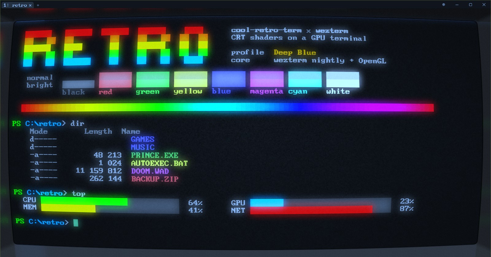
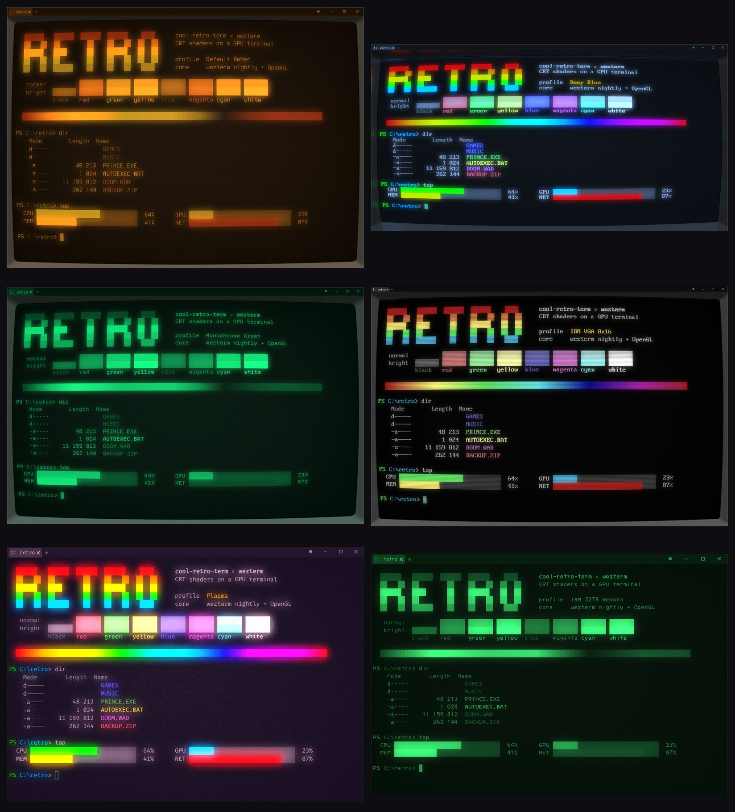

# cool-retro-term (Windows Port)

|> Default Amber|C:\ IBM DOS|$ Default Green|
|---|---|---|
||||

## Branch `wezterm-host`: wezterm with the CRT look

On this branch the roles are flipped: **wezterm itself is the application**
and cool-retro-term's CRT effects are ported into wezterm's OpenGL renderer.
Every wezterm feature works (multiplexer, splits, SSH/WSL domains, ligatures,
images, key tables, Lua config, ...) with the cool-retro-term look on top.





*Profiles: Default Amber, Deep Blue, Monochrome Green, IBM VGA 8x16, Plasma,
IBM 3278 Reborn.  Profiles with chroma show the program's colors (16 ANSI
colors and 24-bit truecolor); the monochrome ones tint everything in the
phosphor color, like the real tubes.*

- `patches/wezterm/*.patch` — our changes to wezterm (applied onto the pinned
  upstream commit in `third_party/wezterm`, local branch `crt`):
  - `config.crt`: cool-retro-term profile + overrides for every effect
  - `wezterm-gui/src/crt/`: bloom, burn-in, frame, static and dynamic passes
    ported from cool-retro-term's shaders
- `wezterm-crt/wezterm.lua` — default portable config (next to the exe)
- `wezterm-crt/wezterm_modules/crt.lua` — applies profiles (font, line height,
  padding, cursor, title bar colors) and the settings menu
- `wezterm-crt/wezterm_modules/crt_data.lua` — profiles and bundled fonts
  (generated by `tools/gen_crt_profiles.py`)
- `wezterm-crt/wezterm_modules/options.lua` — the Settings menu: every
  wezterm setting without editing Lua
- `wezterm-crt/wezterm_modules/options_catalog.lua` — all 219 wezterm options
  with type, values, default, category and description (generated by
  `tools/gen_wezterm_options.py` from the wezterm sources and docs)
- `build_wezterm_crt.ps1` — applies patches, builds, assembles `dist-wezterm\`
  (needs Rust msvc, VS 2022, Strawberry Perl for the vendored OpenSSL);
  `-WeztermRef main` builds on the latest wezterm instead of the pinned commit,
  `-Zip` also writes the release package and its `.sha256`.  Machine specific
  paths (e.g. `$PerlDir = '...'`) go into `build.local.ps1`, which git ignores
- `tools/export_wezterm_patches.ps1` — refresh patches after committing on `crt`
  (the patch headers get a neutral author, no personal name or e-mail)
- `.github/workflows/build-wezterm-crt.yml` — builds releases on GitHub
- `wezterm-crt/update.ps1`, `wezterm-crt/wezterm_modules/update.lua` — the
  Update menu and the installer it starts

```lua
-- dist-wezterm\wezterm.lua
crt.apply(config, { profile = 'Monochrome Green', bloom = 0.8, burn_in = 0.5 })
```

Window chrome: no OS title bar; tabs and the minimize / maximize / close
buttons sit in wezterm's own title bar, drawn flat (no CRT effects) above the
curved screen.  Mouse clicks and selection on the curved screen are mapped
through the same distortion the shader uses.

The mouse pointer is reflected for a sense of depth: a faint, blurred image
in the convex glass (pulled towards the centre and bent by the bulge) and a
mirrored one in the bezel next to the text reflection (wrapped around the
rounded corners).  Its strength is **CRT effects > Pointer reflection**
(`pointer_reflection`, 0 turns it off); the size follows the Windows pointer
size setting.  For screenshots, `WEZTERM_CRT_DEBUG_POINTER=x,y` (or
`x,y,text` for the I-beam) places a fixed pointer instead of the mouse.

Settings: the **gear** button in the title bar (or **Ctrl+Shift+,**) opens a
menu on the CRT screen with the main categories only: **Profile**, **Font**,
**CRT effects** (on/off, every effect value, rasterization, phosphor color,
reset), **Full screen**, **Settings** and **Reset settings**.  Arrow keys (or
j/k) move, Enter picks, Esc goes one level up, / searches.  CRT choices are
saved in `crt_state.json` next to the exe and applied to all windows at once.
In **CRT effects** every value is a slider: Left/Right (or h/l) move it in
steps of 0.05, Shift+Left/Right in steps of 0.01, and the change shows on the
screen right away while the menu stays open; Enter still opens the list of
values with the profile default.  A **Colors** row shows the 16 terminal
colors through the CRT, so you can see how chroma, saturation, contrast or
the phosphor change them, and **Phosphor color** has a square in the color
the screen gives it.  (wezterm gets an optional
`slider = { value, min, max, step, names }` per `InputSelector` choice,
reported to the action callback as a fifth argument, and
`window:set_crt_preview{...}`, which shows CRT values at once without a
configuration reload; the saved values are picked up by all windows when the
slider rests.)

**Settings** lists every wezterm setting (219 options; the structured ones
such as `window_padding`, `window_frame` and `colors` are split into their
fields, 312 entries) in 20 categories with the current value and a
description, plus a search over all of them, editing `wezterm.lua`, reloading
the configuration and the command palette.  Each option gets an editor for
its type: on/off, a list of values, flag check boxes, a typed value (numbers,
sizes like `1cell`, colors, font names or a pick from the installed fonts),
list and NAME=VALUE editors, and a link to its documentation page.  wezterm
validates every value before it is saved; a rejected value is explained in
the menu.  Values are saved in `wezterm_options.json` next to the exe and win
over `wezterm.lua`; **Reset settings** removes them.  The 23 options that are
Lua structures (key bindings, domains, launch menu, ...) open `wezterm.lua`
instead.

Full screen: **F11** or **Alt+Enter**.  The title bar hides and slides in over
the screen when the mouse touches the top edge (`crt.fullscreen_autohide_tab_bar`).

Updates: **Settings > Update** shows the installed version and checks the
latest release of this repository.  **Install** opens an update window that
downloads the package, checks its SHA-256, closes wezterm, replaces the
program files and starts wezterm again; settings saved by the menu and an
edited `wezterm.lua` are kept (the new default goes to `wezterm.lua.new`) and
the previous version is copied to `%TEMP%\crt-update\<tag>\backup`.
**Build a new version** creates a `crt-*` tag, which makes GitHub Actions build
the latest wezterm `main` (what wezterm's nightly builds use) with the CRT
patches and publish it as a release, in about an hour.  GitHub access goes
through the GitHub CLI (`gh auth login`) when it is installed, which is needed
for private repositories and to start builds; public releases are also read
without it.

## WezTerm core (this fork)

This fork replaces Konsole's `Vt102Emulation` with the **wezterm-term** emulation core
from [WezTerm](https://github.com/wezterm/wezterm) (git submodule `third_party/wezterm`):

- `wezbridge/` — Rust cdylib exposing wezterm-term through a C ABI (`wezbridge.h`).
- `qmltermwidget/lib/WezEmulation.*` — feeds pty output into wezterm, mirrors its screen,
  cursor and scrollback into Konsole's `Screen` (so the CRT renderer, selection and
  scrollbar are unchanged), and routes keys / mouse / paste through wezterm's encoders.
- ConPTY: wezterm's bundled `conpty.dll` + `OpenConsole.exe` are side-loaded when present
  next to the exe (much newer than the Windows 10 inbox ConPTY).

Environment switches: `CRT_EMULATION=konsole` (legacy emulation), `CRT_CONPTY_INBOX=1`
(system ConPTY), `CRT_CONPTY_PASSTHROUGH=1` (experimental ConPTY passthrough).

Build: Rust (stable, msvc), Qt 6.8 msvc2022_64, VS 2022, then
`powershell -ExecutionPolicy Bypass -File build_wezterm.ps1 [-QtDir ...] [-Zip]` → `dist\`.

## Description
cool-retro-term is a terminal emulator which mimics the look and feel of the old cathode tube screens.
It has been designed to be eye-candy, customizable, and reasonably lightweight.

This is the **Windows 11 port** by [pushingpandas](https://github.com/pushingpandas), based on the original [cool-retro-term](https://github.com/Swordfish90/cool-retro-term) by Filippo Scognamiglio.

It uses the QML port of qtermwidget (Konsole) with a custom Windows ConPTY backend replacing the POSIX PTY layer.

Settings such as colors, fonts, and effects can be accessed via the **menu bar** at the top and the **right-click context menu**. Both are available on Windows.

## Download & Run

1. Download the latest `.zip` from the [Releases](https://github.com/pushingpandas/cool-retro-term-windows/releases) page
2. Extract the zip to any folder
3. Run `cool-retro-term.exe` from the extracted folder

The exe and all required Qt6 DLLs are in the same folder — no installation needed.

> **Building from source?** After running `nmake`, the exe is at `app\release\cool-retro-term.exe`. See [Building on Windows](#building-on-windows) for full instructions.

## Screenshots


## Windows Port Details

### What was changed
- **ConPTY backend**: New `conpty.cpp`, `conptydevice.cpp`, `conptyprocess.cpp` replace POSIX PTY for terminal I/O on Windows using the Windows Pseudo Console API (ConPTY)
- **Threaded pipe I/O**: Reader/Writer threads with `ReadFile`/`WriteFile` (Windows anonymous pipes don't work with `QSocketNotifier`)
- **mmap emulation**: `win32_compat.h` provides `mmap`/`munmap`/`getpagesize` via `VirtualAlloc` for terminal history
- **OpenGL rendering**: Forces OpenGL backend since D3D11's FXC shader compiler can't handle the CRT effect shaders
- **Shell detection**: Finds PowerShell Core (`pwsh`) > Windows PowerShell (`powershell`) > `cmd.exe`
- **Consolas fallback font**: Uses Consolas as the monospace fallback on Windows
- **Menu bar**: Always visible on Windows (File, Edit, View, Profiles, Help)
- **Shader compilation**: All 63 shader variants recompiled with HLSL 5.1 support

### Requirements
- Windows 10 version 1809+ (for ConPTY API) or Windows 11
- Qt 6.8+ (MSVC 2022 build)
- Visual Studio 2022 (Build Tools or Community)

## Building on Windows

### Prerequisites
1. Install [Visual Studio 2022](https://visualstudio.microsoft.com/) (Community edition or Build Tools) with "Desktop development with C++" workload
2. Install [Qt 6.8+](https://www.qt.io/download) for MSVC 2022 64-bit
3. Make sure `qmake` is in your PATH (e.g., `D:\Qt\6.8.3\msvc2022_64\bin`)

### Build
```batch
rem Open a "x64 Native Tools Command Prompt for VS 2022" or run:
call "C:\Program Files\Microsoft Visual Studio\2022\Community\VC\Auxiliary\Build\vcvarsall.bat" x64
set PATH=D:\Qt\6.8.3\msvc2022_64\bin;%PATH%

cd cool-retro-term
qmake cool-retro-term.pro -spec win32-msvc
nmake
```

Or use the provided `build_win.bat` (edit paths to match your Qt installation first).

### Compile Shaders
```batch
rem Edit compile_shaders.bat to set your Qt qsb.exe path, then:
compile_shaders.bat
```

### Deploy
```batch
mkdir deploy
copy app\release\cool-retro-term.exe deploy\
cd deploy
windeployqt cool-retro-term.exe

rem Copy QMLTermWidget plugin
mkdir qt6\qml\QMLTermWidget
copy ..\qmltermwidget\release\qmltermwidget.dll qt6\qml\QMLTermWidget\
copy ..\qmltermwidget\src\qmldir qt6\qml\QMLTermWidget\
copy ..\qmltermwidget\src\QMLTermScrollbar.qml qt6\qml\QMLTermWidget\

rem Move Qt6 DLLs to qt6/ subfolder for a clean layout
mkdir qt6
move Qt6*.dll qt6\
move D3Dcompiler_47.dll qt6\
move opengl32sw.dll qt6\
rem Also move: generic, iconengines, imageformats, networkinformation,
rem platforms, qml, qmltooling, sqldrivers, styles, tls, translations into qt6/

rem Install Qt5Compat.GraphicalEffects (download from Qt if not present)
rem Install Qt6ShaderTools.dll into qt6/
```

### Run
Launch via `cool-retro-term.bat` (sets DLL paths) or run `cool-retro-term.exe` directly if Qt6 DLLs are in PATH.

## Original Project

Based on [cool-retro-term](https://github.com/Swordfish90/cool-retro-term) by Filippo Scognamiglio.
For Linux and macOS builds, see the [original repository](https://github.com/Swordfish90/cool-retro-term).

## License
GPL v3 - see [LICENSE](LICENSE) file.

Windows port Copyright (C) 2024 pushingpandas.
Original Copyright (C) 2013-2021 Filippo Scognamiglio.

## Contact

Windows port: A. Prior — [a.prior@pushingpandas.io](mailto:a.prior@pushingpandas.io) | [pushingpandas.io](https://pushingpandas.io)
